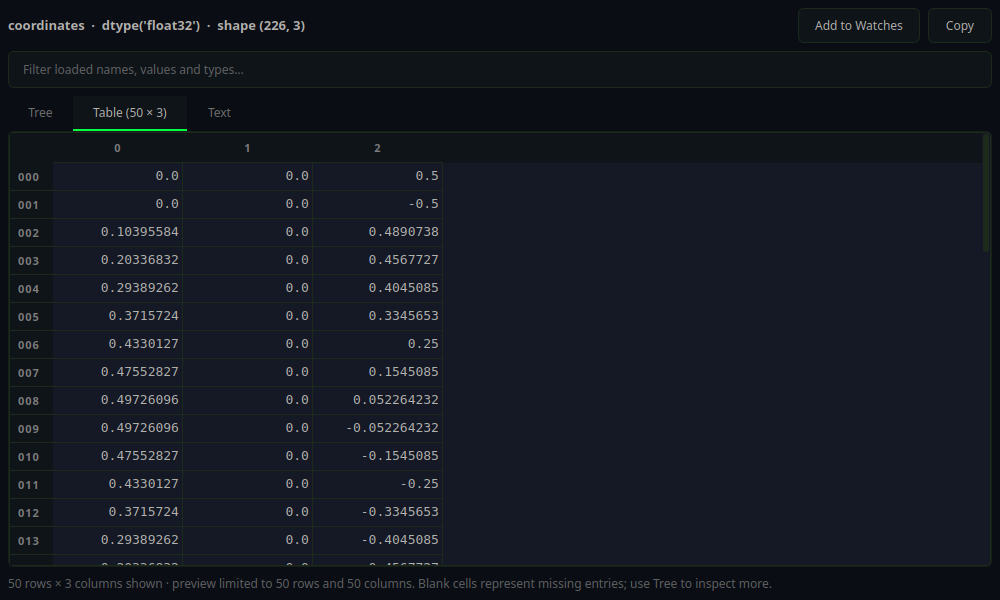
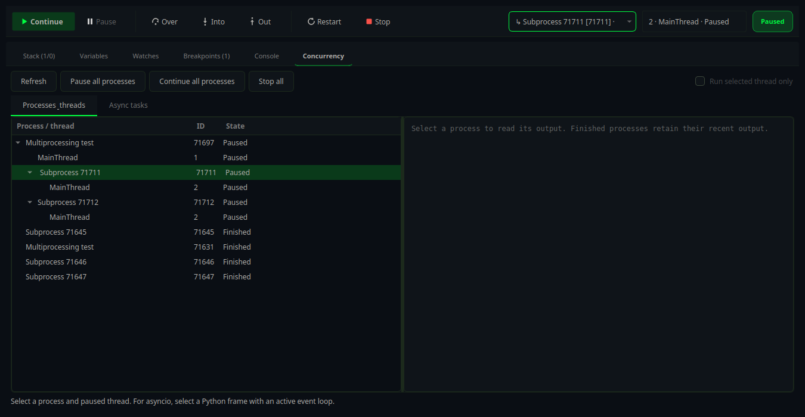
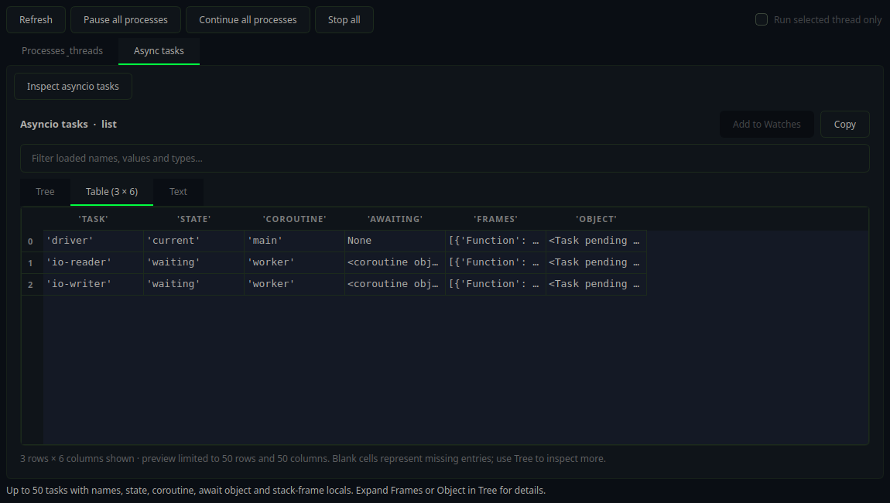

# Lightpad User Manual

## Introduction

Lightpad is a modern, lightweight code editor designed for developers. It provides essential features for code editing while maintaining fast performance and a clean interface.

## Getting Started

### Installation

#### Linux (Ubuntu/Debian)
```bash
git clone https://github.com/djeada/Lightpad.git
cd Lightpad
./scripts/install-deps.sh
mkdir build && cd build
cmake ..
cmake --build .

# Run
./App/Lightpad
```

#### Windows
1. Install Qt 6.x development tools
2. Install CMake 3.10 or later
3. Build using CMake GUI or command line

#### macOS
```bash
brew install qt cmake
git clone https://github.com/djeada/Lightpad.git
cd Lightpad
mkdir build && cd build
cmake ..
cmake --build .
./App/Lightpad.app/Contents/MacOS/Lightpad
```

### First Launch

When you first launch Lightpad:
1. A new empty file opens automatically
2. Use `Ctrl+O` to open existing files
3. Use `Ctrl+N` to create new files

## Basic Usage

### Workspace Controls

Use **Go to file…** (`Ctrl+P`) in the workspace header to find a file. Run,
Debug, and Test show the current target; their arrows open the target menus.
Long names keep their full descriptions in tooltips. The breadcrumb hides at
narrow widths, while the file tabs remain available.

Language, indentation, diagnostics, and cursor position live in the bottom
status bar. Tool panels have Close and Float/Dock buttons. The Tests panel
separates run controls from name/status filters; **Options** contains automatic
runs and configuration settings. **Clear filters** restores hidden results
without losing them.

### Opening Files

- **Menu:** File → Open (or `Ctrl+O`)
- **Drag and drop:** Drag files from file manager onto Lightpad
- **Command line:** `lightpad filename.txt`

### Editing Text

Lightpad works like any standard text editor:
- Click to position cursor
- Type to insert text
- Select text by clicking and dragging
- Use clipboard shortcuts (`Ctrl+C`, `Ctrl+X`, `Ctrl+V`)

### Saving Files

- **Save:** `Ctrl+S` or File → Save
- **Save As:** `Ctrl+Shift+S` or File → Save As
- Unsaved files show an indicator in the tab

### Working with Tabs

- Each file opens in a new tab
- Click tabs to switch between files
- Middle-click or `Ctrl+W` to close a tab
- Drag tabs to reorder them

## Features

### Building and Debugging CMake Projects

When you start debugging a C/C++ file inside a project that contains a
`CMakeLists.txt`, Lightpad builds the project automatically before launching
the debugger:

1. The project is configured on first use (`cmake -S . -B build`); results are
   cached in `build/`.
2. `cmake --build build -j<nproc>` compiles the targets, with a progress
   dialog showing live output (Cancel aborts the build).
3. If `CMakeLists.txt` declares exactly one executable target, it is selected
   automatically; with several targets a picker dialog appears.
4. The debug session launches against the freshly built binary.

Notes:
- Override the build directory per configuration with `"cmakeBinaryDir"` in
  the launch configuration.
- A `preLaunchTask` string in the debug configuration runs as a shell command
  from the project root before the CMake step (useful for code generators).
- Projects without `CMakeLists.txt` keep the single-file behavior: the current
  file is compiled with `-g -O0` when its binary is missing or stale.

### Inspecting Debugger Values

While paused at a breakpoint, double-click a variable or watch (or choose
**Inspect Value…** in its context menu) to open a resizable value inspector.
The debug console also shows an inspector beside the latest expression result;
drag the divider to resize it or use **Inspector** to hide it. **Detach** opens
the console and inspector together in a larger window.

- **Tree** expands nested lists, dictionaries, and objects on demand. Large
  indexed collections load 100 items at a time; double-click **Load next 100
  items…** or select it and press Enter for the next page.
- **Table** aligns nested sequences by column index and records by field name.
  Nested lists open here automatically. Row and column headers identify each
  element, and ragged rows leave missing cells blank. The preview shows up to
  50 rows and 50 columns; use Tree for more. Select cells and use **Copy** or
  `Ctrl+C` to copy tab-separated values into a spreadsheet.
  Double-click a cell (or press Enter) to open its value in Tree, including
  nested objects and task-frame locals.
- **Text** shows the selected value with nested containers indented. The
  formatter preserves quoted strings and leaves incomplete adapter output
  unchanged. Text previews are limited to 65,536 characters.

The filter searches loaded names, values, and types without fetching the whole
object. **Add to Watches** follows an expression while stepping. Variable trees
remember expanded paths across steps, and full values remain available in
tooltips and the inspector even when their inline previews are shortened.

After execution resumes, an open inspector keeps its loaded values as a
clearly marked snapshot. Evaluate the expression again at the next pause to
refresh it; old object references are never used to fetch new children.

For Python, install `debugpy` into the Python environment selected for the
project (for example, `.venv/bin/python -m pip install debugpy`).

Adapters may impose their own container limits; evaluate a narrower slice to
inspect a different part of a large array. Reproducible VTK and OpenGL debugger
tests are documented in [the graphics fixtures](../tests/fixtures/debugger/README.md).



### Processes, Threads, and Async Tasks

The debugger toolbar has separate process and thread selectors. Selecting a
paused thread changes the stack, variables, watches, console frame, and the
thread used by Continue and Step. Switching context clears old values before
loading the new frame.

Open **Concurrency → Processes & threads** for the process hierarchy, thread
names and IDs, and paused/running states. Double-click a process to focus it,
a paused thread to inspect its stack, or a running thread to request a pause.
Each process has its own output; the last 20 finished sessions retain recent
output here. **Pause all processes**, **Continue all processes**, and **Stop all**
operate across sessions. Stopping a parent also stops its child sessions.

Python debugpy sessions automatically follow subprocesses when `subProcess`
is enabled (the Python quick configuration enables it). Source, function,
and exception breakpoint edits reach background child sessions as well.
Data watchpoints stay with the process that created them.
Automatically attached Python children capture stdout and stderr for their own
consoles unless `redirectOutput` is explicitly disabled. The parent's inherited
stream can also include worker output.



**Run selected thread only** enables single-thread Continue and Step when
the adapter advertises support. Otherwise the control is disabled and the
adapter's normal execution behavior applies. A partial resume keeps other
paused threads available for inspection. Python threads blocked in native
calls may not suspend until they return to Python; debugpy can expose their
stack while refusing variable evaluation. Lightpad displays that failure
instead of presenting empty locals as a successful result.

For asyncio, pause in a Python frame inside the event-loop thread, then open
**Concurrency → Async tasks → Inspect asyncio tasks**. The table shows up to
50 unfinished tasks in that loop with names, states, coroutines, await objects,
and up to 12 stack frames each. Open a **Frames** cell to expand frame locals;
**Object** exposes the task itself. Inspection is explicit and evaluates in
the selected frame. It does not run or resume a coroutine. The result becomes
a snapshot when execution resumes or the selected frame changes; inspect
again at the next pause. Completed tasks and other event loops are outside
this snapshot.



### Syntax Highlighting

Lightpad automatically detects the programming language based on file extension:

| Extension | Language |
|-----------|----------|
| `.cpp`, `.cc`, `.h`, `.hpp` | C++ |
| `.py` | Python |
| `.js`, `.jsx` | JavaScript |
| `.ts`, `.tsx` | TypeScript |
| `.java` | Java |
| `.rs` | Rust |
| `.go` | Go |

### Source Control: Commit History

The Source Control panel shows recent commits for the current repository. Right-click a commit in the history list to:
- **Checkout Commit** to view files at that revision (detached HEAD)
- **Create Branch** to start a new branch from that commit

### Merging Branches

Press **Merge…** in the Source Control panel to combine two branches. The merge
screen asks four questions in order and answers each one before anything runs:

1. **Which work do you want to bring in?** Pick a branch. When the same branch
   name exists both on this machine and on a remote, Lightpad asks which copy you
   mean and warns you when the two are not at the same commit.
2. **Where it lands.** The branch you are standing on. It is the only one that
   changes; the branch you are merging from is left untouched.
3. **What will happen.** How many commits come in, how many files they touch,
   and which files are likely to need a decision from you. If the merge cannot
   start — uncommitted edits, another half-finished operation — it says so
   instead of failing halfway.
4. **If the same lines disagree.** Decide each one yourself (the default), or
   have one side always win. This step is hidden when the merge cannot conflict.

### Resolving Merge Conflicts

When a merge stops, the **Merge Conflicts** panel opens by itself
(`Ctrl+Shift+K`, or **View → Toggle Merge Conflicts**). It lists every file the
merge is waiting on, how many separate spots inside each file still need an
answer, why each one clashed, and how far along you are. It stays up until the
merge is finished, so the **Finish the merge** button is where you left it once
the last file is settled.

Opening a conflicted file does not show you raw `<<<<<<<` markers. Instead the
file becomes a list of numbered cards, one per disagreement, showing:

- **YOUR VERSION** — what is on the branch you are standing on
- **THEIR VERSION** — what is coming in

Each side names the branch it came from and how many lines it is. For every
disagreement you can keep one side, keep both in either order, keep neither, see
what both branches started from, or type the replacement yourself. Long stretches
of unchanged code are folded away and can be unfolded on demand.

Every choice is undoable (`Ctrl+Z`), a decided card can be reopened with **Change
my mind**, and `Alt+Down` / `Alt+Up` walk between disagreements. **Save and mark
fixed** only becomes available once nothing is left undecided; until then the
file stays unmerged as far as Git is concerned, so partial work is never
mistaken for a finished file.

### Git Objects and Packfiles

Use **View → Git → Objects & Packfiles…** to search full or abbreviated hashes
across packfiles and loose objects. Select a pack to browse its index, inspect
text or binary contents, follow object relationships, or verify its integrity.
**Object DAG** explores dependencies; **Commit Graph (DAG)** shows branch and
merge topology. See [Git objects, packfiles, and DAGs](GIT_OBJECT_EXPLORER.md)
for storage scopes, navigation, and shortcuts.

### Opening Large or Binary Files

Reading a file into the editor costs far more memory than the file itself: the
bytes, then a UTF-16 copy, then the document built on top — roughly seven times
the file size. A few hundred megabytes is therefore enough to exhaust memory and
end the process, and binary files are worse still, because they have no line
breaks and land on a single enormous line.

Lightpad now checks a file before reading it:

- **Large text files** (8 MB or more) offer a read-only preview of the first
  2 MB, opening the whole file anyway, or cancelling.
- **Binary files** (detected by a NUL byte in the opening 8 KB, the same rule
  Git uses) offer a read-only look or cancelling.

A preview holds only part of the file, so it opens read-only and **saving it is
refused** — writing the buffer back would discard everything after the preview.
Autosave skips previews for the same reason.

### Line Numbers

Line numbers are displayed by default. Toggle them in:
- **Preferences** → **Editor** → **Show line numbers**

### Auto-Indentation

Lightpad automatically indents new lines based on the previous line. Configure:
- **Preferences** → **Editor** → **Auto indent**
- **Preferences** → **Editor** → **Tab width**

### Bracket Matching

Matching brackets are highlighted when the cursor is on a bracket. Toggle:
- **Preferences** → **Editor** → **Highlight matching brackets**

### Current Line Highlighting

The current line is subtly highlighted. Toggle:
- **Preferences** → **Editor** → **Highlight current line**

### Inline Git Blame

To show who last changed the current line and its commit details beside the
code, enable **Preferences** → **Display** → **Show inline Git blame**. It is
off by default. Changes apply immediately to all open editors and are saved
for future sessions.

### Databases

Open **Database → Database Panel** (`Ctrl+Shift+D`) to connect to SQLite,
SQL Server, PostgreSQL or MySQL/MariaDB - directly or inside a Docker
container - browse tables, run SQL from `.sql` files (`F9`) or the console, and
inspect, export and profile results. See [DATABASE_TOOLS.md](DATABASE_TOOLS.md).

### Autocompletion

Trigger autocompletion with `Ctrl+Space`. See [AUTOCOMPLETION.md](../App/AUTOCOMPLETION.md) for details.

## Recover Unsaved Work

Use **File → Recover Unsaved Documents…** to review recovery drafts from interrupted
sessions. Preview and select drafts, then restore them into new unsaved tabs.
Untitled documents are protected too, even when Auto Save is off. Source files
remain unchanged until you choose where to save the recovered text.

See [Document Recovery](DOCUMENT_RECOVERY.md) for checkpoint timing, limits,
Save / Don't Save / Cancel behavior, and storage details.

## Find and Replace

### Basic Find

1. Press `Ctrl+F` or go to Edit → Find
2. Type your search term
3. Press `Enter` or click Find Next
4. Use `F3` for next match, `Shift+F3` for previous

### Find and Replace

1. Press `Ctrl+H` or go to Edit → Replace
2. Enter search term and replacement
3. Choose Current file, Selection, Open files, or Project in the scope selector
4. Click Replace to change the selected match, or Preview changes to review a batch
5. In the preview, uncheck matches or files to exclude, then click Apply replacements

Open editors remain unsaved; closed project files are saved with atomic writes.
Undo replacement restores the last batch if the affected files have not changed.
See [Search and Replace](SEARCH_REPLACE.md) for matching rules, file filters,
keyboard shortcuts, supported encodings, and replacement safeguards.

### Find Options

- **Case Sensitive:** Match exact case
- **Whole Word:** Match complete words only
- **Regular Expression:** Use regex patterns

## Customization

### Color Themes

Change the editor theme:
1. Go to **Preferences** → **Appearance**
2. Select a theme from the dropdown
3. Changes apply immediately

### Font Settings

Customize the editor font:
1. Go to **Preferences** → **Editor**
2. Choose font family and size
3. Enable/disable font ligatures

### Editor Settings

Configure editor behavior:
- **Tab width:** Number of spaces per tab (default: 4)
- **Insert spaces:** Use spaces instead of tabs
- **Word wrap:** Wrap long lines
- **Show whitespace:** Display space/tab characters

## VIM Mode

Lightpad supports VIM-style modal editing:

1. Enable VIM mode in **Preferences** → **Editor** → **VIM Mode**
2. The editor starts in Normal mode
3. See [KEYBOARD_SHORTCUTS.md](KEYBOARD_SHORTCUTS.md) for VIM commands
4. Put your own mappings, abbreviations and `:set` options in the `vimrc` file next to Lightpad's `settings.json` (on Linux `~/.config/Lightpad/Lightpad/vimrc`); Lightpad runs it when Vim mode starts (`:e $MYVIMRC` opens it, `:source` reloads a file)

## Language Server Protocol (LSP)

For enhanced code intelligence:

1. Install a language server for your language
2. Configure the language server path in Preferences
3. Features include:
   - Code completion
   - Hover information
   - Go to definition
   - Find references
   - Inline diagnostics

### Go to Definition

Lightpad supports Go to Definition for C/C++, Python, Rust, Go, TypeScript/JavaScript, and Java via dedicated language servers. Each server is auto-detected and started on demand.

See [Go to Definition](GO_TO_DEFINITION.md) for installation instructions for each language server.

## Plugins

Lightpad supports plugins for extensibility:

### Installing Plugins

Place plugin files in:
- Linux: `~/.local/share/lightpad/plugins/`
- Windows: `%APPDATA%/Local/Lightpad/plugins/`
- macOS: `~/Library/Application Support/Lightpad/plugins/`

### Available Plugin Types

- **Syntax Plugins:** Add highlighting for new languages
- **Theme Plugins:** Add custom color themes
- **Tool Plugins:** Add new features and tools

## Troubleshooting

### Lightpad Won't Start

1. Check Qt libraries are installed
2. Run from terminal to see error messages
3. Try deleting config: `~/.config/lightpad/`

### Slow Performance

1. Check file size (very large files may be slow)
2. Disable syntax highlighting for large files
3. Check for running language servers

### Syntax Highlighting Wrong

1. Check file extension matches language
2. Manually set language: View → Set Language
3. Report issue if language not supported

## Accessibility

### High Contrast Themes

Use high contrast themes for better visibility:
- **Preferences** → **Appearance** → **High Contrast**

### Font Scaling

Increase font size for readability:
- `Ctrl++` to zoom in
- `Ctrl+-` to zoom out
- `Ctrl+0` to reset

### Keyboard Navigation

All features are accessible via keyboard shortcuts. See [KEYBOARD_SHORTCUTS.md](KEYBOARD_SHORTCUTS.md).

## Getting Help

- **Documentation:** https://github.com/djeada/Lightpad/docs
- **Issues:** https://github.com/djeada/Lightpad/issues
- **Contributing:** See [CONTRIBUTING.md](../CONTRIBUTING.md)
